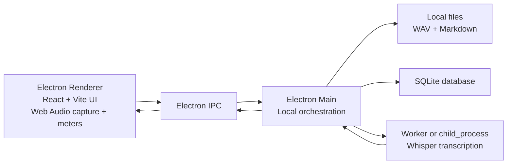
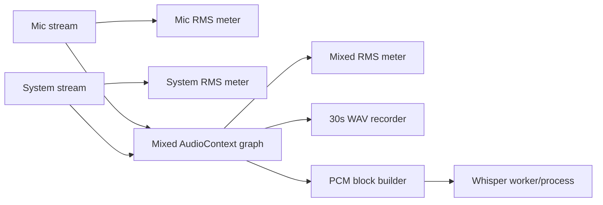

# Local Architecture

## Architecture Decision

The MVP is a single local Electron app. There is no backend server and no WebSocket.

Electron Main is the local orchestrator. The Renderer owns the interactive UI and Web Audio graph. IPC is used for privileged local operations such as desktop source discovery, file writes, SQLite access, export, and worker/process orchestration.

## Process Boundaries



## Responsibilities

### Renderer

- Render `Audio Diagnostics`.
- Enumerate microphone devices via `navigator.mediaDevices.enumerateDevices`.
- Request microphone capture via `getUserMedia`.
- Request system/display audio capture through Electron/Chromium APIs.
- Build Web Audio nodes for mic, system, and mixed streams.
- Compute live RMS, silence, and clipping indicators.
- Keep capture and UI state easy to inspect.
- Send recorded WAV bytes to Main for local saving.

### Main Process

- Create the desktop window.
- Expose a narrow preload API.
- List desktop sources with `desktopCapturer`.
- Return platform and app paths.
- Save WAV files into app-local recordings.
- Initialize and query SQLite.
- Export Markdown.
- Start/stop transcription workers or child processes.

### Preload

Expose only typed APIs needed by the renderer:

- `platform.getInfo()`
- `audio.getDesktopSources()`
- `files.saveWav()`
- `db.*`
- `transcription.*`
- `export.markdown()`

No Node integration is exposed directly to the renderer.

## Audio Pipeline

The MVP pipeline has two local paths:



The first implementation prioritizes diagnostics and WAV correctness. Transcription can initially be mocked once the audio blocks are available.

## Persistence Model

SQLite tables:

```sql
CREATE TABLE meetings (
  id TEXT PRIMARY KEY,
  title TEXT NOT NULL,
  started_at TEXT NOT NULL,
  ended_at TEXT,
  status TEXT NOT NULL,
  audio_path TEXT
);

CREATE TABLE transcript_segments (
  id TEXT PRIMARY KEY,
  meeting_id TEXT NOT NULL,
  start_ms INTEGER NOT NULL,
  end_ms INTEGER NOT NULL,
  text TEXT NOT NULL,
  status TEXT NOT NULL CHECK (status IN ('partial', 'final')),
  source TEXT NOT NULL CHECK (source IN ('mic', 'system', 'mixed')),
  created_at TEXT NOT NULL,
  FOREIGN KEY (meeting_id) REFERENCES meetings(id)
);

CREATE TABLE qa_messages (
  id TEXT PRIMARY KEY,
  meeting_id TEXT NOT NULL,
  question TEXT NOT NULL,
  answer TEXT NOT NULL,
  context_mode TEXT NOT NULL,
  created_at TEXT NOT NULL,
  FOREIGN KEY (meeting_id) REFERENCES meetings(id)
);
```

## Transcription Worker Strategy

MVP sequence:

1. Mock transcription worker accepts block metadata and returns deterministic placeholder text.
2. Real local Whisper is added behind the same worker contract.
3. The worker accepts PCM 16 kHz mono blocks and returns segment text plus timing.

Preferred real options:

- Whisper CLI or Python child process first, because it is easy to isolate and debug.
- Node `worker_threads` for in-process PCM preparation if needed.
- `whisper.cpp` or faster-whisper later, chosen by installation and packaging constraints.

## Ask Strategy

Ask uses persisted transcript text only.

MVP context mode:

- `last_2_minutes`

If the recent transcript has too little content, answer:

> No hay suficiente transcripción reciente para responder con confianza.

Optional providers later:

- Ollama local.
- OpenAI/OpenRouter only when explicitly configured by the user.

